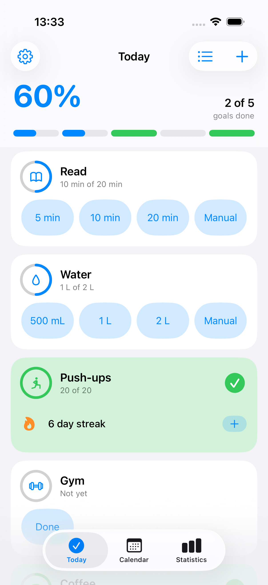
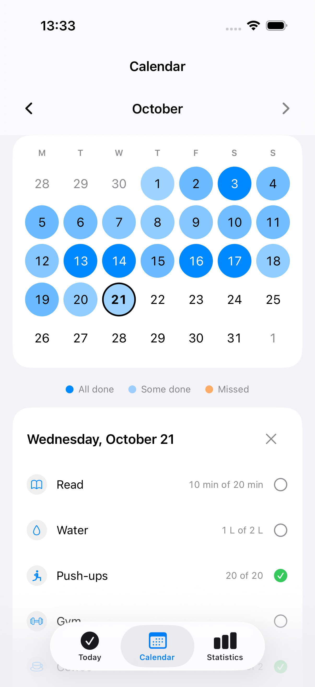
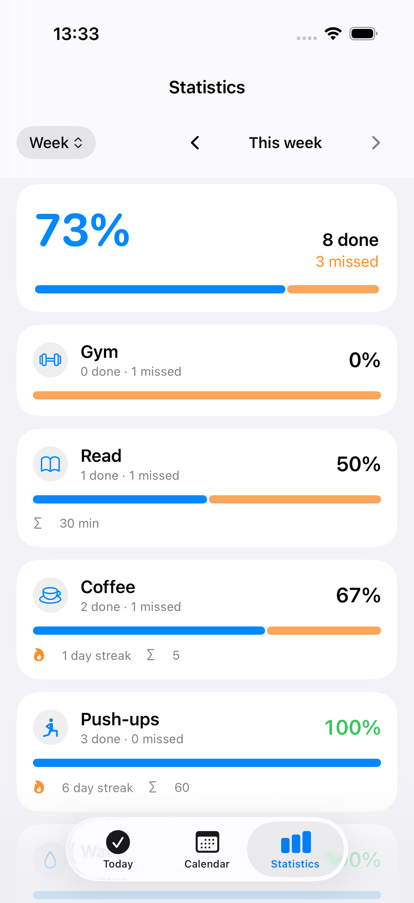
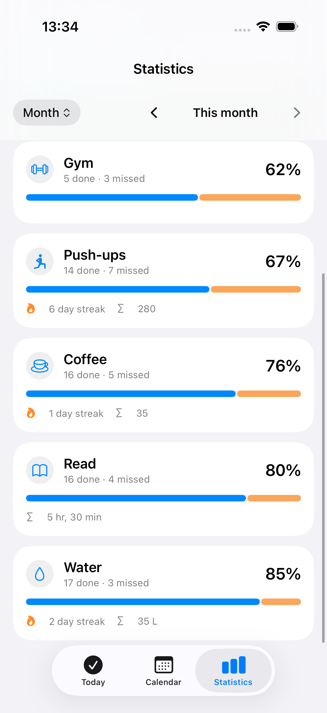
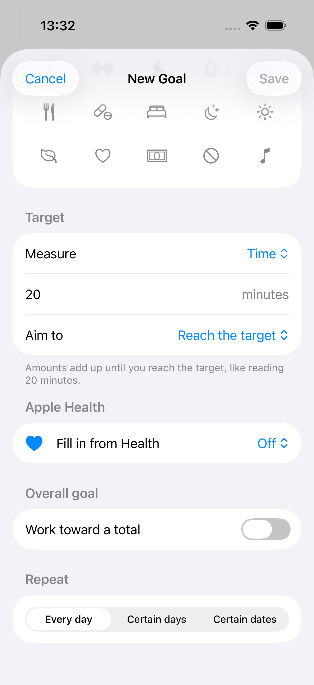
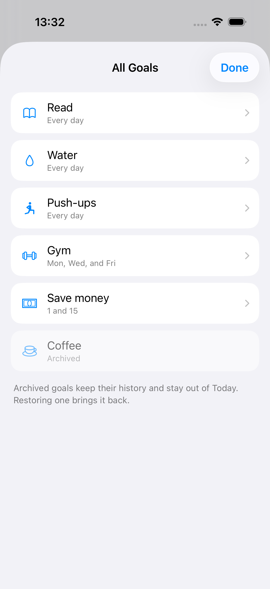
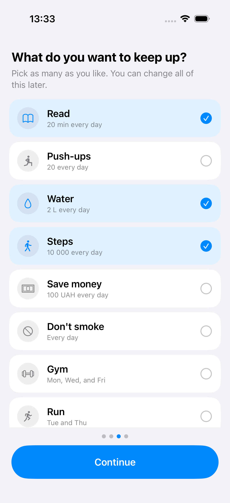
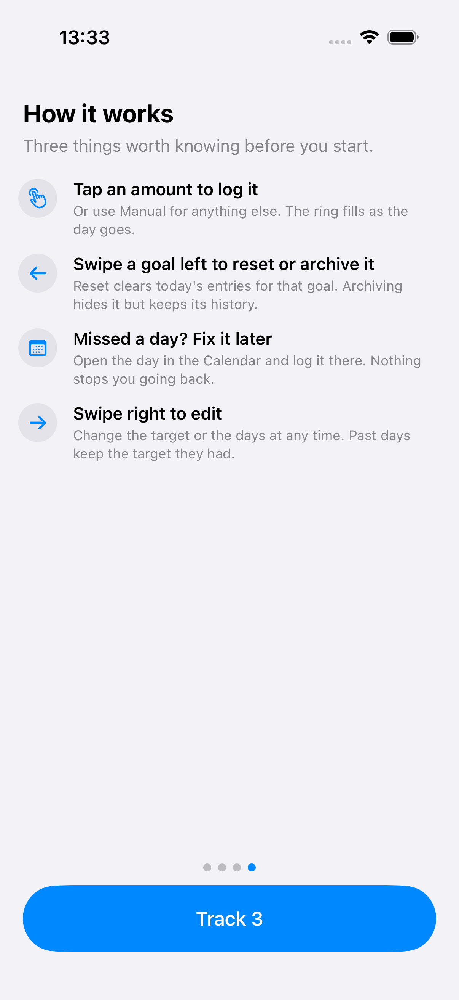
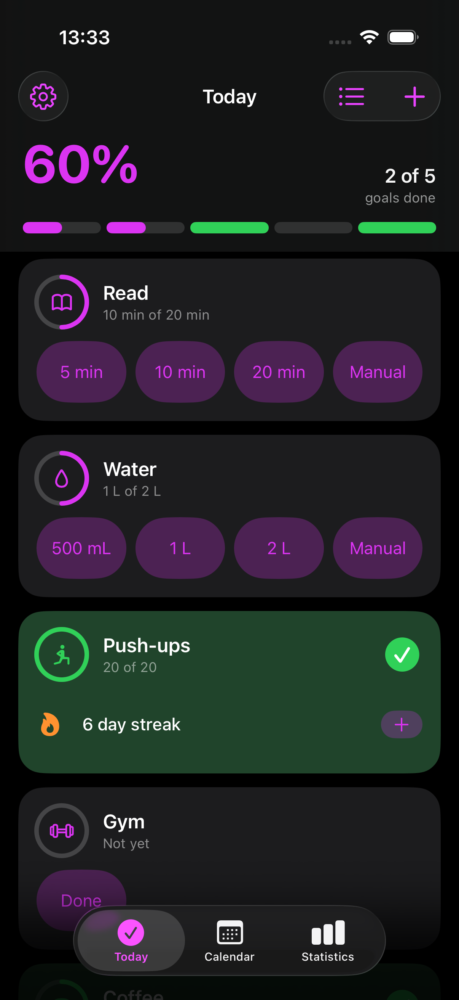
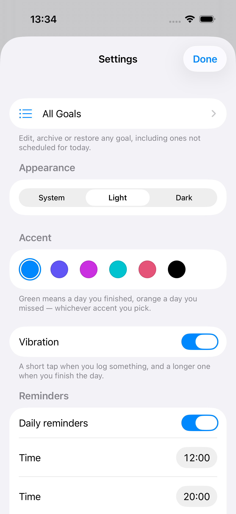

# Patch

A goal and habit tracker for iPhone, built in SwiftUI.

**On TestFlight:** [testflight.apple.com/join/W2KmuhsA](https://testflight.apple.com/join/W2KmuhsA)

Reading twenty minutes a day, a hundred push-ups, two litres of water, money put
aside when the salary lands, a day without smoking — Patch treats all of these as
the same thing, and that single idea shapes the whole codebase.

| Today | Calendar | Statistics |
|---|---|---|
|  |  |  |

---

## The core idea

Most habit trackers model each kind of goal separately, which means every new
goal type touches the schema, the UI and the statistics code. Patch doesn't.
Every goal is *an amount accumulated toward a daily target, in a direction*:

| Goal | Kind | Direction | Logged as |
|---|---|---|---|
| Read 20 minutes | `duration` | `atLeast` | 10 min + 10 min |
| 100 push-ups | `count` | `atLeast` | 20 + 30 + 50 |
| 2 litres of water | `volume` | `atLeast` | 8 × 250 ml |
| Don't smoke | `count` | `atLeast` 1 | one confirmation a day |
| Save 4 000 UAH | `currency` | `atLeast` | on the 1st and the 15th |
| 10 000 steps | `count` | `atLeast` | filled in from Apple Health |

Adding a new kind of goal means adding a `MeasureKind`, not migrating the store
or branching the UI.

Three consequences fall out of this that are worth calling out.

**Patch records what you did, never what you avoided.** "Don't smoke" was first
modelled as `atMost 0`, so a day with no entries already succeeded and the only
available action was admitting a slip — a button that undoes the user's own
goal, sitting on a row already marked complete. It now works like any other
once-a-day goal: you confirm it. The tick means you actually said so, rather
than meaning the clock has not caught you yet.

**Amounts are always stored in a canonical unit** — seconds, millilitres,
metres. Display units are a presentation concern. Totals, comparisons and
(later) sync never have to care how a number was entered. Money is the one
exception, because 100 is a different amount in dollars, euros and hryvnia, so
a currency goal carries an ISO code alongside it.

**Changing a goal never rewrites its past.** Raising "read 20 minutes" to an
hour used to turn every finished day behind it into a failure, because progress
judged the whole history against whatever the target happened to be now. A goal
keeps the targets it has had and the day each took effect, and every day is
judged against the one that was actually in force.

## Architecture

```
Packages/PatchKit/
  Sources/PatchCore/        Pure Swift. No SwiftUI, no SwiftData, no UIKit.
    Measure.swift           What a goal asks of a day, and in what unit
    Schedule.swift          Which days it asks on — daily, weekdays, or dates
    Goal.swift              The goal itself
    TargetHistory.swift     What it asked for on any given day
    Entry.swift             One logged contribution
    Reminder.swift          A time of day, not an instant
    DayProgress.swift       How one goal stands on one day
    ProgressCalculator.swift
    StreakCalculator.swift
    CumulativeProgress.swift  Long-run targets: "save 60 000 by March"
    QuickAdd.swift          Suggested one-tap logging amounts
    ManualAmounts.swift     The picker's range, when one tap is not enough
    Statistics.swift        Done/missed over day, week, month, year, custom
    GoalTemplate.swift      Ready-made goals for onboarding
    GoalStore.swift         The persistence contract, plus an in-memory store
    GoalOrder.swift         The order goals appear in, and what a drag does
    HealthSource.swift      What Apple Health may fill a goal in with
    HealthImportPlanner.swift  Turning a day's step count into entries
    WidgetSnapshot.swift    What the home screen needs to know about today
    Export.swift            JSON backup and CSV, byte-stable
  Sources/PatchStore/       The only place that imports SwiftData
  Tests/                    192 tests, ~40 ms, no simulator needed

Patch/                      SwiftUI app target — 151 unit tests
  Patch/Localizable.xcstrings   English, Ukrainian, Russian — 220 keys
  PatchWidget/              Home screen and Lock Screen widgets
  PatchUITests/             Simulator tests, deliberately out of CI
```

The domain layer imports nothing but `Foundation`. That is the point: all the
logic worth testing — progress, clamping, streaks, schedules, target history,
corrections — is testable in milliseconds without booting a simulator, and
persistence can be swapped without touching any of it.

**Calendars are injected, never global.** `ProgressCalculator` and
`StreakCalculator` take a `Calendar`, so tests pin UTC and a Monday
first-weekday and behave identically on a laptop in Kyiv and a CI runner
elsewhere.

**Entries are append-only in spirit.** Correcting a mistake adds a negative
amount rather than mutating history, which keeps a day's total auditable and
avoids edit conflicts once CloudKit sync is enabled.

**The store is CloudKit-shaped from the first commit** — every property
defaulted or optional, no unique constraints, no relationships; goals and
entries are linked by `goalID`. Turning sync on is meant to be a capability
checkbox rather than a migration.

### Product rules encoded in the domain

Deliberate, documented and tested, because each of them is a decision rather
than an implementation detail:

- **Unscheduled days are skipped, not failed.** A weekday-only gym habit keeps
  its streak across the weekend.
- **Today is forgiving.** If today is scheduled but not yet done, the streak is
  measured from yesterday rather than displayed as zero. Resetting someone's
  streak at 00:01 punishes them for the clock, not their behaviour.
- **"Missed" means genuinely missed.** Statistics exclude days before the goal
  was created, days still in the future, and an unfinished today. Without this,
  every new goal opens on a wall of red for a month it was never set during.
- **A rate of 0% is not the same as no data.** A window where nothing has
  settled yet shows a dash, not a confident zero.
- **A date the month does not have falls on its last day.** Someone paid on the
  31st is still paid in February. Skipping would be invisible — an unscheduled
  day does not even break a streak.

### Logging should take one tap, and fit the goal

A goal's shape decides how it is logged, so the domain exposes a `LoggingStyle`
rather than leaving the view to guess: goals that accumulate get a row of
amounts, goals that happen once a day get a single **Done** button.

Suggested amounts scale with the target and snap to round numbers people
actually say:

| Goal | Suggestions |
|---|---|
| Read 20 minutes | 5 min · 10 min · 20 min |
| 100 push-ups | 25 · 50 · 100 |
| 2 litres of water | 500 ml · 1 L · 2 L |
| 10 000 steps | 2 000 · 5 000 · 10 000 |

Three, plus **Manual** for anything else — four equal slots, so every goal's
controls line up down the screen rather than each row finding its own rhythm.

**A goal card is exactly as tall when it is done as when it is not.** Both
halves are always laid out, one of them transparent. That is not a styling
choice: when the height changed, `UITableView` animated the row height
underneath SwiftUI and the card drew across its neighbour, because `List` does
not clip rows. A constant height makes the bug impossible rather than
suppressed, and the space a finished card was wasting now carries its streak.

### Long-run goals

A daily target answers "what should I do today". Some goals also need "where am
I heading" — save 60 000 by March, read a hundred hours this year. Those are
tracked separately from the daily rhythm, with an optional date.



Reaching the target early and then letting the date pass is a success, not a
failure. Once a date has gone, no per-day figure is offered, because none of
them rescues it.

## Apple Health fills goals in; it does not own them



A count goal can read your step count, a distance goal your walking distance, a
time goal your exercise minutes. Patch tops the goal up as the day goes and you
can still log by hand — both count.

**The row names what it will read.** It was a switch saying "Fill in from Apple
Health", on the reasoning that each measure has exactly one source so a picker
was overkill. A tester made a goal called *Squats*, turned it on, and Patch
filled it with their step count: 2 000 of 50, done for the day. The goal was
not wrong to offer it — "walk 10 000" may well be called something else — but
an app has to say what it is about to read at the moment of choosing, not in a
footnote below the fold.

Matching on the goal's *name* would be the obvious fix and is the wrong one: it
breaks the moment someone renames a goal, and it cannot work across three
languages plus whatever people actually type.

**Imports are deltas, not totals.** Entries are immutable and Health's figure
for today climbs all day, so each refresh writes the difference between what
Health says and what this goal has already imported. A day going 2 000 → 5 000
→ 7 432 steps lands as three entries summing to 7 432, not 14 432. Only
imported entries count toward that, so a tap you made by hand is never
swallowed. A *falling* total is honoured too — deleting a workout in the Health
app takes the day back down, because a goal that stayed high would claim
something you had just said did not happen.

**Nothing claims the goal is connected**, because iOS will not say. Read
permission cannot be queried — Apple reports a refusal identically to a day
with no steps, since "this app knows you declined" is itself a disclosure. So
the footer points at Settings rather than inventing a status.

## On the home screen and the Lock Screen

Small and medium on the home screen; circular, rectangular and inline on the
Lock Screen. All of them read a snapshot file the app writes after every
change — never the database.

**The widget cannot log, and that is the decision.** Letting an extension write
would mean two processes mutating the same store, and for an app whose whole
value is accumulated history, a widget that can only ever show a stale number
is worth more than one-tap logging. A tested migration into the App Group was
written for it and then deleted rather than left lying around.

The medium size shows as many goals as fit and **counts the rest** — "+2 more"
— because a widget showing four of eight and saying nothing is lying by
omission. The small size says what is *next* rather than repeating the
overview. Lock Screen widgets render monochrome, so none of them leans on green
to mean "done"; the tick carries it, exactly as it does for anyone using the
app in greyscale.

## Every goal, including the ones today has no use for

| All goals | |
|---|---|
|  | Today shows what is scheduled for today, which is right for Today and left a hole: a goal set to Tuesdays and Thursdays was, on a Wednesday, **completely unreachable** — not visible, not editable, not archivable. Archived goals had the same problem permanently, because archiving was a one-way door with no unarchive anywhere in the app. |

Reached from Today's toolbar or from Settings. Long press any row to edit,
archive, restore, or — once archived — delete for good. Deleting is the only
irreversible thing in Patch, so it asks first, names the goal, and says that
its entries go too.

Requiring a goal to be archived before it can be deleted is the guard. It is
also how someone finds out whether they actually wanted it gone.

## Goals go in the order you want them

Long press a goal on Today, choose **Reorder**, drag, then Done. Calendar and
the widget follow the same order; Statistics keeps sorting by completion rate,
because it answers "what is slipping" and a manual order would bury the 0% goal
among the finished ones.

Creation date decided this until recently, which is an implementation detail
showing through the glass — "Read, Water, Push-ups" is the order a seeder
happened to insert them in, not an order anybody chose.

Sorting is `(sortIndex, createdAt)`, and every goal that already existed has an
index of zero, so until someone drags something the creation date still decides
and the list is exactly what it was. That tie-break is the whole reason this
could be added without a migration.

Dragging cannot start from a long press, because that gesture already belongs
to the context menu — a drag on top of it does not lift the card, it slides
onto a menu item and fires it. A UI test caught that resetting a goal's
progress on the way past. The menu offers the mode instead, which is the same
answer Apple gives on the Home screen.

## Onboarding

| Choose what to track | How it works |
|---|---|
|  |  |

Three preselected, because an empty list asks someone who has just opened the
app to invent their own habits before they know what it does. Picking none is
allowed — someone who wants to write their own should not have to untick a
decoy first. The last page covers the three things that cannot be discovered by
looking: tap to log, swipe left to reset or archive, swipe right to edit.

## Making it yours

| Today | The same day, themed | Where you change it |
|---|---|---|
|  |  |  |

Light, dark or follow the phone, and six accent colours.

**Green and orange are not part of the theme.** Green means *a day you
finished* and orange *a day you missed*; letting them follow the accent would
mean the same card reads green-for-finished under one theme and
green-for-in-progress under another, and someone who learnt the screen once
would have to learn it again. That is also why the accent palette has no green
in it — the one distinction the Today screen exists to draw is the one an
accent must never blur.

`Color.accentColor` is not how any of this works, which is worth knowing before
reaching for it: it reads the asset catalog and ignores `.tint(_:)` entirely.
Every call site that needs the accent as a *value* — a fill, an opacity, a
stroke — takes it from the environment instead.

### Reminders are for the app, not for each goal

One set of check-in times — 12:00 and 20:00 by default, up to four — rather
than a time on every goal.

Per-goal reminders sounded thorough and were worse three ways. They nag: five
habits with a time each is five notifications a day, and nothing gets an app's
notifications switched off faster. They are tedious to keep. And they silently
broke — **iOS allows 64 pending local notifications per app**, and one request
per day a goal runs on meant ten weekday goals asking for seventy. iOS keeps
the 64 soonest and discards the rest without an error, so some reminders simply
never arrived.

Four whole-app check-ins cannot reach that ceiling, and a test pins it.

### Vibration

A light tap when you log something, a success note when a goal finishes, and
two beats when the last goal of the day goes green. Reset is a rigid click:
undoing work should feel like a switch thrown back, not like more work done.
All of it is one switch away in Settings.

The event is chosen by comparing the day before and after the entry lands,
because "you finished something" is a transition and not a property of the
number — the identical call is a light tap on the way to twenty push-ups and a
success note on the one that reaches twenty.

## There are no accounts, deliberately

Patch has no sign-in screen, no password, and no server.

Syncing is planned through **CloudKit's private database**, which is not a
login: the user is already signed into iCloud, so their goals reach a new
iPhone without an account system existing at all. No credentials to lose, no
recovery flow to build, and no one else's habit data on anybody's server.

It is worth being accurate about what that would add, since it is easy to
oversell. A new iPhone already keeps everything: the store lives in Application
Support, which iCloud Backup and direct device transfer both carry across.
Sync would buy three things backup does not — a copy that cannot silently stop
when iCloud storage fills, two devices at once, and surviving the app being
deleted.

### And your data can leave

"We never send it anywhere" would be a hollow promise if the data could never
get out either — a lock with no key. Settings exports everything as a file you
keep: **JSON** for a complete backup, every field of every goal and every
entry including archived ones, in a shape that can be read back; or **CSV**,
one row per goal per day, which is what opens usefully in a spreadsheet.

Amounts in the CSV are in canonical units with a column naming them, because
formatting them for display would make the file depend on who exported it. Two
exports of the same data are byte-identical, so backups can be diffed.

A third-party login like Google would only buy something if there were a backend
to talk to, and there isn't one — it would mean building and paying for a
server, and becoming the data controller for other people's personal routines,
to deliver what CloudKit gives for free. The one thing that would change this
is an Android version, since CloudKit does not exist there.

## Getting started

```bash
git clone git@github.com:aldev0090git/patch-ios.git
cd patch-ios

# Run the app
open Patch/Patch.xcodeproj

# Or just the domain layer — no Xcode project needed
cd Packages/PatchKit && swift test
```

Requires **Xcode 27 or later** to open the project. The app targets **iOS 26.0**
and **iPhone only** — the Xcode template's multiplatform defaults were removed,
because nothing here has ever been built or designed for a Mac or an iPad.

The app icon is generated rather than committed as an opaque binary:

```bash
swift Tools/make-app-icon.swift Patch/Patch/Assets.xcassets/AppIcon.appiconset
```

The screenshots above come from `ScreenshotUITests`, which launches the app
with a `-demo-data` argument and captures every screen in both appearances. The
seeder behind it is `#if DEBUG` only and cannot reach a release build.

The widgets are the exception: **the simulator's widget gallery is empty** on
the iOS 26.5 runtime — not missing Patch, missing everything including Apple's
own. Widget layout can only be checked on a device.

The theme is set by launch argument rather than by driving the Settings screen,
because `UserDefaults` reads `-key value` pairs straight off the command line —
so the capture exercises the app's real stored setting, and asserts that the
swatch it launched with comes back selected.

## Roadmap

- [x] Domain model — measures, schedules, progress, streaks, target history
- [x] Quick-add suggestion engine and manual entry
- [x] Statistics — done/missed over day, week, month, year, custom ranges
- [x] SwiftData persistence behind a store protocol
- [x] Today, Calendar and Statistics screens
- [x] Create, edit and archive goals
- [x] Onboarding from goal templates
- [x] Daily reminders — a nudge for the app, not an alarm per goal
- [x] Currencies, dates-of-month schedules, long-run targets
- [x] Localisation — English (base), Ukrainian, Russian
- [x] CI — build, test and lint on every push
- [x] App icon
- [x] Themes — light/dark/system and six accents — and haptics
- [x] Backdating — fill in a day you forgot, from the Calendar
- [x] Accessibility — VoiceOver, Dynamic Type, 44pt targets, Reduce Motion
- [x] Data export — JSON backup and CSV, through the share sheet
- [x] On TestFlight
- [x] Home screen widget — small and medium
- [x] Lock Screen widgets — circular, rectangular and inline
- [x] Apple Health — steps, walking distance and exercise minutes
- [x] Reordering goals, and a screen that lists every one of them
- [ ] iCloud sync via SwiftData + CloudKit

## Localisation

English, Ukrainian and Russian, with English as the source language.

Units are formatted by Foundation rather than assembled by hand. Writing
`"\(value) min"` would need "хв" in Ukrainian and "мин" in Russian, and would
still get plural forms and decimal separators wrong in both — 1.5 L is "1,5 л"
in both languages, with a comma. `MeasureFormatter` takes an injectable
`Locale` so tests pin a language rather than depending on the machine running
them.

Goal templates carry a *key*, not a word, and the key travels onto the goal, so
a seeded goal still follows the phone's language months later. Renaming a goal
clears the key — a name someone typed is theirs, and translating it out from
under them would be wrong.

> The Ukrainian and Russian strings were written without a native reviewer and
> are worth a second pair of eyes.

## Tooling

Swift 6.2 · SwiftUI · SwiftData · WidgetKit · HealthKit · Swift Testing ·
SwiftLint (`--strict` in CI) · GitHub Actions

343 tests in all — 192 in the domain package, which need no simulator and run
in about 40 ms, and 151 in the app. UI tests sit outside CI and exist to catch
what the others structurally cannot: a screen that renders empty, a row that
draws across its neighbour, a confirmation whose only button is Delete.
